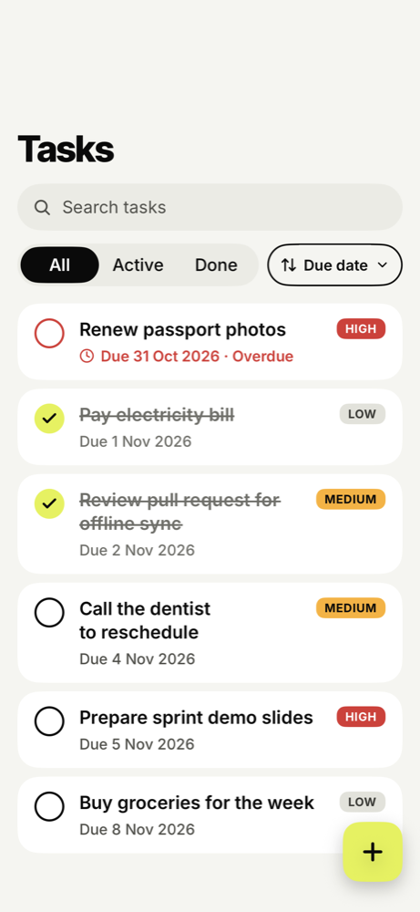
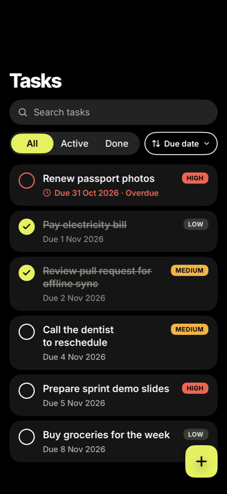
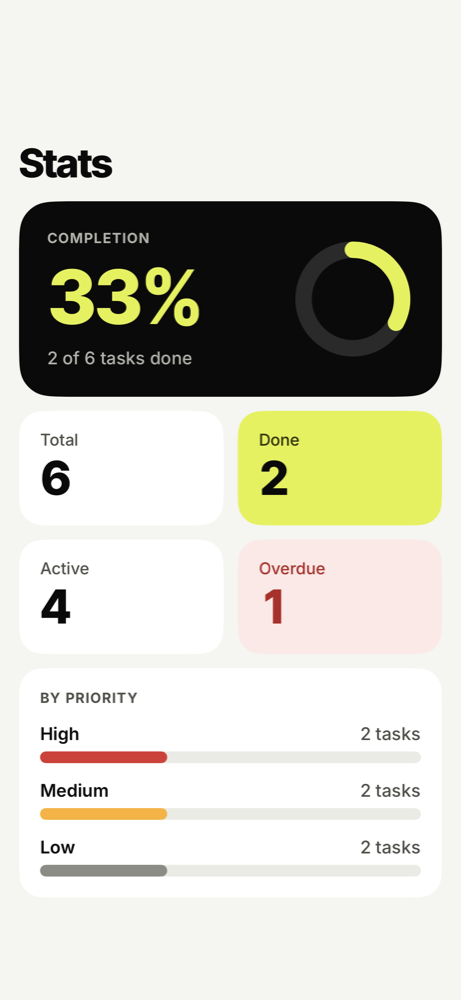

# KMPBrownfield-ios

SwiftUI Tasks app on top of a **Kotlin Multiplatform** core. The domain, data and presentation
(ViewModel) layers come from [KMPBrownfield-shared](https://github.com/Kaktotaks/KMPBrownfield-shared)
as a prebuilt XCFramework via Swift Package Manager; this app keeps SwiftUI views, navigation and a
thin Swift presentation layer. It is the iOS half of a brownfield KMP migration — the Android twin
is [KMPBrownfield-android](https://github.com/Kaktotaks/KMPBrownfield-android), and both follow the
same [product spec](https://github.com/Kaktotaks/KMPBrownfield-shared/blob/main/docs/SPEC.md).

How the app got here: [`docs/MIGRATION.md`](docs/MIGRATION.md) (brownfield migration log).

- iOS 17.0+, SwiftUI app lifecycle, Swift 5 language mode
- One dependency: the `Shared` package (`https://github.com/Kaktotaks/KMPBrownfield-shared`,
  *Up to Next Minor*; `Package.resolved` is committed). No Gradle or JDK in the iOS build.
- Combine `ObservableObject` for the Swift ViewModels and the generic `SharedViewModel` bridge
- Data: `GET https://jsonplaceholder.typicode.com/todos?_limit=20` seeds the local SQLite database once
  (shared 0.7.0, offline-first); afterwards tasks, edits and voice notes persist across restarts and the
  app works offline

## Design

The UI follows the approved redesign — [`docs/design/DESIGN_HANDOFF.md`](docs/design/DESIGN_HANDOFF.md) (tokens, components,
screens, motion, copy, accessibility, acceptance criteria). It is a visual-layer change only: the shared module and its
ViewModels are untouched, and both apps look and behave the same except the chrome listed in handoff §0. The sort pill's
"Title" option comes from `SortOrder.TITLE` (shared 0.6.0).

| List | List (dark) | Stats |
|---|---|---|
|  |  |  |

More states (detail, editor with validation errors, error, empty) are in [`docs/design/screenshots`](docs/design/screenshots)
next to the Android counterparts. Screenshots of the two apps differ in data only (the iOS ones use the fake-data preview
graph, the Android ones the live JSONPlaceholder data).

## Voice notes (shared 0.7.0)

A task can have **one optional voice note** (up to 2:00), recorded and played back in Task detail (card under
Notes) and in the New / Edit task sheet (section under Due date); the list shows a mic + duration indicator.
All recorder / player logic (state machine, timer, 2:00 limit, 1:50 warning, < 1 s discard, 40-bar waveform,
speed, file lifecycle) is in `shared`; the app provides only thin native adapters and the UI
(handoff: `docs/design/` and the voice-notes design handoff).

- **Adapters** (`TasksApp/Voice/`): `AVVoiceRecorder` (AAC .m4a, mono, 44.1 kHz, 64 kbps, metering, dB -50...0 -> 0...1),
  `AVVoicePlayer` (`AVAudioPlayer`, rate 1x / 1.5x / 2x), `AVMicPermission` (`AVAudioApplication`). Each voice-note
  ViewModel gets its own recorder and player; only the permission provider is shared.
- **Permission**: `NSMicrophoneUsageDescription` = "Record voice notes for your tasks." (`Config/TasksApp-Info.plist`).
  Our own explainer card shows first; after a denial the card offers "Open Settings"
  (`UIApplication.openSettingsURLString`); granting it there works on return (`scenePhase` active -> `onAppForegrounded`).
  Leaving the app (`scenePhase` inactive/background) or an audio interruption stops a recording (keeping the clip) or pauses playback.
- **UI** (`TasksApp/UI/Voice/`): `VoiceNoteCard`, `VoiceRecorderView`, `VoicePlayerView`, `WaveformView`,
  `MicPermissionCard`, `VoiceNoteIndicator`; Swift `VoiceNoteCardViewModel` (Combine `ObservableObject`) wraps the Kotlin
  `VoiceNoteViewModel`; Replace / Delete use a system `.alert` (as in the reference screenshots).
- **Debug fakes** (DEBUG builds only, compiled out of Release): launch arguments for deterministic simulator runs
  (same names as the Android intent extras):

| Argument | Meaning |
|---|---|
| `-fakeVoiceAudio` | fake recorder (moving levels), player (wall clock) and permission, plus the sample tasks in an in-memory database |
| `-fakeMicPermission notDetermined\|granted\|denied` | initial permission (default `granted`) |
| `-fakeMicDenyOnRequest` | the "system dialog" answers Don't Allow |
| `-forceVoiceError recordFailed\|unavailable` | start throws / seeded notes cannot be played |
| `-seedVoice "5:42000,4:18000"` | `taskId:durationMs` notes attached after the load |

  e.g. `xcrun simctl launch booted com.example.tasks.ios -fakeVoiceAudio -fakeMicPermission notDetermined -seedVoice "5:42000"`

## Build and run

1. Open `TasksApp.xcodeproj` in **Xcode 16 or newer** (the project uses objectVersion 77).
   Xcode resolves the `Shared` package and downloads `Shared.xcframework.zip` from the GitHub Release.
2. Pick an iOS 17+ simulator, then **Cmd+R** to run, **Cmd+U** to run the tests.

For a physical device, select your team under Signing & Capabilities (the development team is empty).

## Architecture

```
SwiftUI View (body only)            TaskListScreen, TaskDetailScreen, TaskEditorScreen, StatsScreen
   │  @StateObject (tab roots) / @ObservedObject (passed in)
   ▼
Swift ViewModel (@MainActor,        TaskListViewModel, TaskDetailViewModel,
 ObservableObject)                  TaskEditorViewModel, StatsViewModel
   │  display-ready state, Bindings, intents, Date ↔ LocalDate, child ViewModel creation
   ▼
SharedViewModel<VM, UiState>        generic bridge: mirrors Kotlin `uiState` (for await) into
   │                                @Published `state`, `send {}`, `clear()` on deinit
   ▼
Kotlin ViewModel (Shared)           TaskListViewModel, … — presentation logic shared with Android
   ▼
Kotlin data + domain (Shared)       TaskRepository (StateFlow<LoadState>), TaskValidator, TaskFilter, …
```

```
TasksApp/
  App/                       TasksMainApp (@main), RootView (system TabView: Tasks, Stats),
                             AppDependencies (composition root: repository, validator, load on start,
                             Kotlin VM + Swift ViewModel factories)
  Theme/                     Color+Tk (Color.tk.<token>), Font+Tk (TKTextStyle), Motion, Metrics (Radius/Spacing),
                             L10n (lookup over Localizable.xcstrings), TKIconPaths (generated, shared with Android)
  Assets.xcassets/           TK/*.colorset (Any/Dark tokens), AppIcon (any/dark/tinted), LaunchBackground
  Fonts/                     Inter 400-700 + Inter Tight 800 (static TTFs, OFL.txt), listed in UIAppFonts
  Localizable.xcstrings      copy, keys identical to Android strings.xml (plural-aware fix_fields / n_tasks)
  Shared+Interop.swift       typealiases (LocalDate, SortOrder) + Date <-> LocalDate helpers
  UI/SharedViewModel.swift   generic ObservableObject bridge around a Kotlin ViewModel
  UI/Components/             TaskCard, CheckCircle, PriorityBadge, StatusBadge, DueLine, PillSearchField,
                             PillSegmentedControl, SortPill, FloatingAddButton, Primary/Secondary/DestructiveButton,
                             SavePill, TasksTextField, DateField, ErrorBanner, HeroCard, InfoRowsCard, StatTile,
                             CompletionRing, AnimatedCountText, PriorityBar, EmptyState, SkeletonRow, TKIcon
  UI/TaskList/               TaskListViewModel, TaskRowItem, TaskListScreen
  UI/TaskDetail/             TaskDetailViewModel, TaskDetailScreen
  UI/TaskEditor/             TaskEditorViewModel, TaskEditorScreen (sheet)
  UI/Stats/                  StatsViewModel (+ StatsSummary), StatsScreen (S1-S5 animations)
  UI/Voice/                  VoiceNoteCard + recorder / player / permission views, VoiceNoteCardViewModel
  Voice/                     native adapters (AVAudioRecorder / AVAudioPlayer / AVAudioApplication), DEBUG fakes
  UI/Preview/                fake-data AppDependencies.preview + #Previews (light + dark) for every screen
TasksAppTests/               XCTest (26 tests + opt-in ScreenshotTests)
```

### SharedViewModel — the Kotlin ↔ SwiftUI bridge
`SharedViewModel<VM, UiState>` (`UI/SharedViewModel.swift`) is the only generic glue, with one
typealias per screen (`TaskListModel`, `TaskDetailModel`, `TaskEditorModel`, `StatsModel`). It:
- **observes `uiState`** with `for await` (SKIE turns `StateFlow` into a typed `AsyncSequence`) and
  mirrors it into `@Published state`. The loop must keep running: Kotlin uses
  `stateIn(WhileSubscribed)`, so `uiState` only updates while collected;
- **destroys the Kotlin VM**: iOS has no `ViewModelStoreOwner`, so `deinit` cancels the loop and
  calls `viewModel.clear()` (iosMain extension → cancels `viewModelScope`);
- **forwards events**: `shared.send { $0.onToggle(id: id) }` calls the Kotlin VM and re-reads
  `uiState.value` synchronously, so text fields bound to the editor's `MutableStateFlow` don't lag;
- **builds Bindings**: `shared.binding(\.title) { $0.onTitleChange(value: $1) }` reads from Kotlin
  state and writes Kotlin events (plus a variant with a conversion, e.g. `LocalDate` ↔ `Date`).

### Screen ViewModels
SwiftUI views are **UI only** — just `body`; no mapping, formatting or calls into Kotlin. Each
per-screen Swift ViewModel exposes:
- **display-ready state** — e.g. `TaskListViewModel.content`
  (`.loading / .error / .empty / .loaded([TaskRowItem])`, mapped from the Kotlin sealed type with
  `onEnum`), `TaskDetailViewModel.details`, the editor's `screenTitle` / `canSave` / `errorMessages`,
  `StatsSummary` rows;
- **bindings** — `Binding` properties such as `model.status`, `model.sort`, `model.query`,
  `model.title`, `model.dueDate`, passed straight to controls:
  `TextField("Title", text: model.title)` (no `$`). The search text is kept in the list ViewModel
  and forwarded to Kotlin, because the list's `uiState` updates asynchronously;
- **intents** — `retry()`, `toggle(id:)`, `toggleDone()`, `delete()`, `save() -> Bool`,
  `openDetail(id:)`, `showNewTaskEditor()` / `showEditor()`, plus picker option lists (Kotlin enums
  are Swift enums with SKIE, but not `CaseIterable`).

Ownership: tab roots hold their ViewModel in `@StateObject` (an autoclosure, so the ViewModel and its
Kotlin VM are created once); child ViewModels are created by the presenting ViewModel —
`detail` for `navigationDestination(item:)` and `newTaskEditor` / `editor` for `sheet(item:)` — and
observed with `@ObservedObject`. So there is exactly one Kotlin ViewModel per presentation, cleared
when it is dismissed. Each Swift ViewModel forwards its `SharedViewModel`'s `objectWillChange`
(nested `ObservableObject`s don't propagate changes on their own).

Why `ObservableObject` rather than `@Observable`: it works on any iOS version a brownfield team is
likely to support. The trade-offs (whole-object invalidation, manual forwarding of nested objects)
are handled as described above.

### Swift-side interop notes
- Kotlin `Task` is exported as **`TaskItem`** (it would clash with Swift Concurrency's `Task`), so the
  app uses plain `Task { }` for concurrency.
- Kotlin `Int` is `Int32` in Swift (ids, stats); `object`s are reached via `.shared`; default
  arguments are not exported.
- With SKIE, Kotlin enums are real Swift enums (exhaustive `switch`, no `default` needed — see
  `Priority+UI.swift`), sealed types are switched with `onEnum(of:)`, `suspend` functions are
  `async`, and `StateFlow`s are typed `AsyncSequence`s.
- kotlinx-datetime `LocalDate` arrives as `Kotlinx_datetimeLocalDate`; `Shared+Interop.swift` aliases
  it to `LocalDate` and converts to/from `Date` via Kotlin `IosDates`. Foundation's `SortOrder` is
  shadowed by `typealias SortOrder = Shared.SortOrder`.
- Implementing a Kotlin `suspend` interface in Swift means implementing SKIE's `__`-prefixed
  requirement — see `FakeTaskApi` in the tests.

## Tests
`TasksAppTests` (XCTest, 26 tests, Cmd+U):
- `SharedInteropTests` — Kotlin domain from Swift (`TodoMapper`, `IosDates`, `DateFormatting`);
- `SharedDataInteropTests` — `TaskRepository` with a Swift fake of the Kotlin `TaskApi` (each test on a fresh in-memory database; state flows are awaited because they lag writes by one emission);
- `VoiceNoteTests` — `VoiceNoteUiState` -> card model mapping, dB -> 0..1 level mapping, spoken durations, and a Swift `AudioRecorder` fake driving the Kotlin `VoiceNoteViewModel` (start / tick / stop with a fixed `MonotonicClock`);
- `SharedViewModelInteropTests` — Kotlin ViewModels from Swift, `SharedViewModel` mirroring and release;
- `ViewModelTests` — Swift ViewModel mapping, bindings and save, empty states, stats fractions, localized copy.
- `ScreenshotTests` — opt-in (`TEST_RUNNER_SCREENSHOT_DIR=… xcodebuild test -only-testing:TasksAppTests/ScreenshotTests`): renders the screens against the preview data into PNGs.

The test target links `Shared` only through the host app (`TEST_HOST`), so there is a single Kotlin
runtime in the process. Business logic itself is tested once, in shared's `commonTest`.

## Updating shared / local development
- Updating = bump the package version (File → Packages → Update to Latest Package Versions) in its
  own PR; `Package.resolved` pins the exact version.
- Changing `shared` and the app together: clone
  [KMPBrownfield-shared](https://github.com/Kaktotaks/KMPBrownfield-shared) next to this repo as
  `../shared`, run `./gradlew assembleSharedDebugXCFramework` there, then in Xcode replace the remote
  package with *Add Package Dependencies… → Add Local…* → `../shared` (its `Package.swift` uses the
  debug XCFramework when it exists). After switching, use File → Packages → Reset Package Caches.
  Do not commit the local package reference.

## AI-assisted workflow
Developed with Claude Code as a pair programmer (commits carry `Co-Authored-By` trailers). The shared
library additionally has an automated Claude PR reviewer focused on the Swift API of the KMP surface —
see [AI-assisted workflow](https://github.com/Kaktotaks/KMPBrownfield-shared#ai-assisted-workflow).

## License
[MIT](LICENSE) © 2026 Leonid Shevchenko
